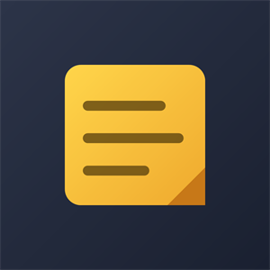
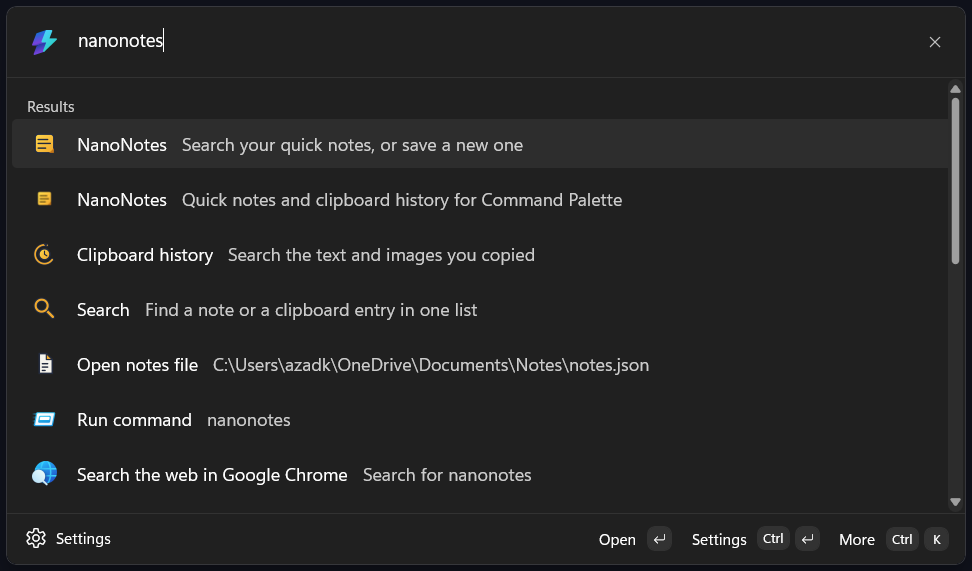
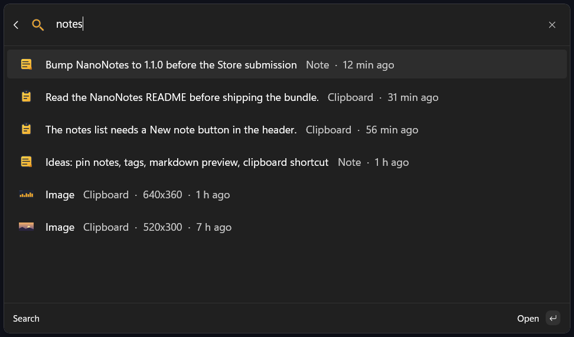
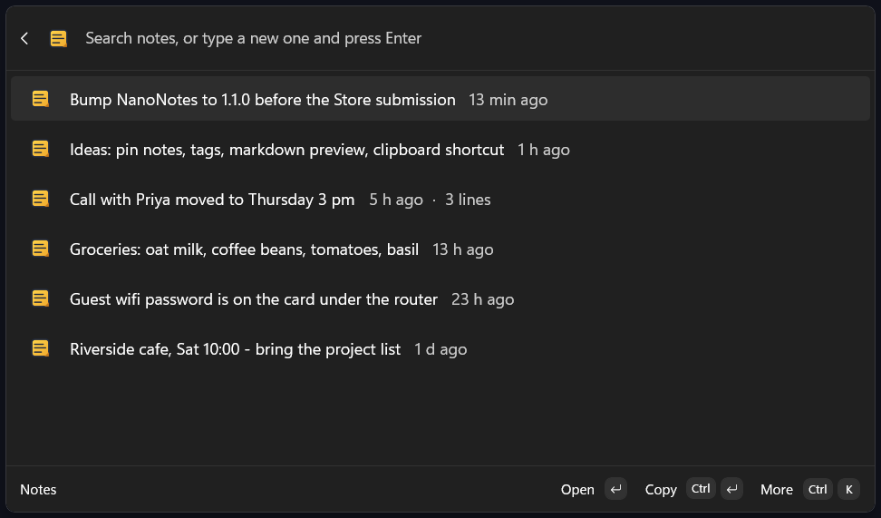
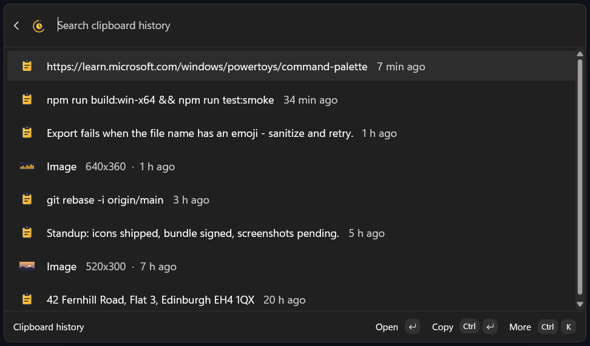

<p align="center">
  
</p>

# NanoNotes

Quick notes and clipboard history for the [Microsoft PowerToys Command Palette](https://learn.microsoft.com/windows/powertoys/command-palette/overview).

NanoNotes is a small Command Palette extension: type a thought and press Enter to
save it as a note, search the notes you saved, and browse back through the text
and images you copied. Everything lives in plain files on your own PC.

## Screenshots

Find NanoNotes in the palette and its commands show up with their own icons:



Search both at once — notes and clipboard history in one list, newest match
first, each row labelled with where it came from:



Your notes, newest first, with age and line count:



Clipboard history, text and copied images together:



## Features

- **Quick notes** — type anything in the palette and save it with Enter; search,
  copy or delete notes from the same list.
- **Clipboard history** — every text (and, if enabled, image) you copy is kept in a
  searchable history; pick an entry to view or re-copy it.
- **Search across both** — one search box looks through your notes and your
  clipboard history together; matches are interleaved newest first and each row
  says whether it is a note or a clipboard item.
- **Your retention, your call** — clipboard history is pruned after 7–30 days
  (14 by default, capped at 500 entries); image capture can be turned off.
- **Readable data** — notes and history are plain JSON/PNG files in
  `Documents\Notes`, editable with any text editor.
- **No network, no accounts** — no telemetry, no analytics, nothing leaves the
  machine. See [PRIVACY.md](PRIVACY.md).
- **Custom icons** — the whole icon family is drawn from vector geometry and
  shipped as assets (see `NanoNotes\Assets`).

## Requirements

- Windows 10 (19041 or newer) or Windows 11
- [.NET 10 SDK](https://dotnet.microsoft.com/download)
- [PowerToys](https://github.com/microsoft/PowerToys) with Command Palette enabled,
  to run the extension

## Build

```powershell
dotnet restore NanoNotes\notes.csproj

# Debug build, then register the loose layout as a local package and restart
# the Command Palette so it picks up the new build.
powershell -NoProfile -ExecutionPolicy Bypass -File build.ps1
```

Open Command Palette (Alt+Space by default) and search for "NanoNotes".

The build script stages the publish output into a sibling `..\layout` folder and
registers `packaging\AppxManifest.xml` from the layout (the same manifest is
mirrored inside this repo so a fresh clone can build). Pass
`-Configuration Release` to build a release configuration.

The Microsoft Store package (signed `x64` + `arm64` `.msixbundle`) is produced by
the separate release tooling that lives with the submission materials, not in
this repository.

## How it works

- `NanoNotes\Helpers\NoteStore.cs` — the notes JSON file (`Documents\Notes\notes.json`).
- `NanoNotes\Helpers\ClipboardStore.cs` — clipboard history + image files
  (`Documents\Notes\Clipboard`).
- `NanoNotes\Helpers\NotesIcons.cs` — brand icons loaded from `Assets\icons`.
- `NanoNotes\Pages` — the notes and clipboard lists and detail pages.

## Privacy

NanoNotes stores your notes and clipboard history locally and never transmits
them. Read [PRIVACY.md](PRIVACY.md) for the full policy.

## License

Copyright (C) 2026 Azad Kshitij.

NanoNotes is free software: you can redistribute it and/or modify it under the
terms of the **GNU General Public License, version 3 or (at your option) any later
version** — see [LICENSE](LICENSE).

If you use this code in your own project, keep the copyright and license notices
and credit the original author (a link back to this repository is enough). Any
modified version you distribute must also be released under the GPL and include
its source code.

NanoNotes is an independent project and is not affiliated with or endorsed by
Microsoft or the PowerToys team.
